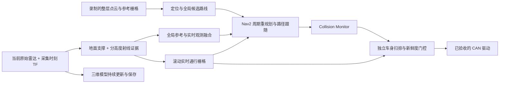

# 整层导航：参考地图辅助，实时观测决定通行（2026-10-31 开发版）

目标是在当前楼层给定目标后自主移动，并继续三维建模。录制地图负责坐标参考、重定位与候选路线；旧图上的空地不构成行驶许可，旧图上的临时障碍也不直接构成永久不可达。没有当前观测的地方保持未知，先停车等待观测或任务中止，不能盲走。

本版本是新增的实时导航开发基线，设备未连接；离线测试与实车验收分别记录。整层点云尚未提供，因此不能声称该楼层已经跑通。

## 数据职责



| 数据 / 话题 | 用途 | 是否能单独放行车辆 |
|---|---|---|
| `/navigation/reference_map` | map_server 只读保存的旧参考图 | 不能 |
| `/map` | 参考代价 + 当前实时观测的全局候选图 | 不能 |
| `/navigation/live_map` | odom 坐标下实时滚动栅格，只有 -1未知 / 0观测可通行 / 100当前障碍 | 结合定位、实际点云、车身预测和底盘健康后才可能放行 |
| `/navigation/live_map_status` | 当前数据新鲜度、有效格数、未知格数、垂直覆盖和失败原因 | 诊断，不是速度指令 |
| `/mapping/global_points`、`local_points` | 累积三维模型，继续 CDR / PLY 保存 | 不能；不使用旧 local_map 轮廓作为当前障碍 |

保存地图中的占据格在全局候选图中降为高代价参考（默认 90），当前新观测障碍为 100，并由 Nav2 映射为致命碰撞代价。新观测确认的空闲格可以覆盖旧图的占据；新障碍可以覆盖旧图的空闲。参考未知区域仍保留未知，当前真实观测可逐步补充；未实现无地图的全楼自主探索。

局部控制不再加载保存的静态地图。使用 Humble 的 StaticLayer 作为**动态 OccupancyGrid 接收插件**，其输入是不断更新的实时栅格，而不是历史静态地图。全局图和局部图的未知值均保留；最终门控另行拒绝未知区域，不能仅依赖 RPP 的未知格处理。

## 实时判断规则

1. 使用 `/lidar/points` 原始返回，按采集时刻 TF 与实际安装外参变换。高于车身的射线终点也保留，用来观测下方净空；不会因车身高度裁剪而丢掉所有天花板射线。
2. 12m 滚动窗口、0.1m 格子；地面支撑加从地面到整车 1.2m 的 0.1m 高度分带射线观测。只有地面回波、没有上部净空证据时，不标为可通行。
3. 新障碍命中优先于同帧清除。移走后必须有新射线穿过旧占据高度，才允许清除；时间到期只变未知，绝不自动变空地。
4. 默认证据寿命 2 秒。原始点云、TF、实时栅格、里程计仍各受更短的新鲜度检查；缓存或重发旧数据不能续命。
5. 每次最终速度输出，检查预测转弯 / 前进轨迹中**整车外形与余量**扫过的格子，而不是只检查车体中心。`live_unknown` / `live_obstacle` 输出零速，等待新证据；实车输入失效会故障锁定。
6. 保留原有约 0.70m 近车停车区、Collision Monitor、限速、CAN 反馈看门狗、未标定 / 未验收拒绝执行。没有删除启动时的近车保护；只是不要求在起步前证明整条远距离路线畅通。

这些是离散雷达观测证据，不是物理安全认证。当前前倾约 46°、离地约 30cm 的单颗雷达能否覆盖整车高度及转弯区域，必须现场检查；覆盖不足时程序应停在 `live_unknown`，需要调整安装或增加传感器，不能用旧地图填补实时盲区。玻璃、极低反射物、楼梯 / 井口、线缆等另做现场验证，录图不能消除这些传感器限制。

## 录制整层点云时保留什么

需要米制、重力方向正确、仅当前楼层的 PLY / PCD 或 `.pc2.lcm`；同时保留原始雷达 / IMU、里程计、TF 和轨迹记录，以便检查长走廊漂移和闭环。只有一份合并点云无法追溯所有漂移、时间同步或外参问题。定位错到相似走廊时，实时避障也不能保证到达正确房间。

新楼层尚无参考地图时，可以使用已有独立建图入口，**不启动导航或 CAN 驱动**：

```bash
# 在已安装 DimOS / FAST-LIO2 的机器、设备接好后执行；不是离线演示。
bash realtime_mapping_usage/start_mid360_raytrace.sh
```

它会连接真实 MID-360 并启用原有 SQLite 数据记录。缓慢覆盖走廊、门口、房间连接、狭窄处和转角，保持同一楼层；原始记录路径以该次后端日志为准。不要和 `start_ros2.sh` 同时启动另一份后端。

在建图仍运行、整层已采完时，另开 Bash 保存最近的完整模型：

```bash
source tracer_navigation/project_env.sh
"$TRACER_MAPPING_VENV/bin/python" tools/capture_floor_cloud.py \
  --output-dir "$TRACER_WORKSPACE_ROOT/data/floors/floor_01_raw" --seconds 15
```

这是只订阅快照工具，不下发运动。输出 `source_cloud.pc2.lcm`、`source_cloud.ply`、`capture.json`；目录已存在则拒绝覆盖。成功后再在建图终端 Ctrl+C，保留 SQLite / 原始记录。不要把累积模型的数量或 Rerun 中“看起来完整”当作尺度与定位验收。

如果是在旧参考图已成功重定位的同一场地扩展，也可用统一启动的 `navigation:=false`，使用现有 ROS 模型记录器；其完整快照中的 PLY 可导入下面流程。

## 导入参考图

原始坐标必须已经重力对齐。`--ground-z` 填该文件中**实际地面高度**，不能把传感器离地高度直接当成它；若地面不是 z=0，就填实际值。下面仅以已经确认地面为 0m 的录图为例：

```bash
source tracer_navigation/project_env.sh
"$TRACER_MAPPING_VENV/bin/python" tools/import_floor_map.py \
  data/floors/floor_01_raw/source_cloud.pc2.lcm \
  --output-dir data/floors/floor_01_reference --ground-z 0
```

也接受 PLY、PCD 和 N×3 `.npy`；PLY / PCD 解析需要后端环境的 Open3D。导入工具生成：

- `raytrace/global_map.pc2.lcm`：重定位三维参考，统一为地面 z=0 的 map 坐标。
- `raytrace/global_costmap.lcm`：二维参考栅格。
- `floor_reference.json`：原始文件 hash、坐标变换、米制、分辨率、参考插补半径和输出 hash。

默认 0.15m 的参考插补只帮助连接候选路线，绝不作为实时通行证据。输出目录必须全新；旧地图和数据不覆盖。

在个人 `config/local.env` 指向新资产（示例用仓库根目录相对位置展开）：

```bash
export TRACER_PREMAP="$TRACER_WORKSPACE_ROOT/data/floors/floor_01_reference/raytrace/global_map.pc2.lcm"
export TRACER_STATIC_MAP_LCM="$TRACER_WORKSPACE_ROOT/data/floors/floor_01_reference/raytrace/global_costmap.lcm"
```

然后重新生成配置，后续重新定位、尺度 / 安装核验和现场验收：

```bash
source tracer_navigation/ros_env.sh
python tracer_navigation/generate_config.py
bash tools/team/doctor.sh --profile integration
```

## 启动与输入目标

完整后端、地图和网络已就绪后，先统一预览；此命令会连接真实传感器，默认不驱动底盘：

```bash
bash tracer_navigation/start_ros2.sh
```

在 RViz 中可分别勾选 `Reference Only` 和 `Live Clearance Evidence`，区分历史参考与实时证据。输入 map 坐标或相对当前车头的前进 / 左移米数：

也可用 RViz 的 Publish Point 选点，并在同一 ROS 域执行 `ros2 topic echo /clicked_point --once` 读取 map 的 x、y，再填入命令。选点本身不触发导航或使能。

```bash
# 默认都只规划，不解锁、不行驶。
bash tracer_navigation/floor_navigate.sh --xy 12.0 8.0
bash tracer_navigation/floor_navigate.sh --relative 20.0 0.0
```

整层任务默认候选路线限额 200m、总时限 3600s，需显式使用该入口；原短程任务仍限 15m。未提高线速度 0.10m/s、角速度 0.15rad/s 或缩小保护范围。`Route` 是绕障总长，不是 A–B 直线距离；系统没有按历史“3m 对 1m”错误做缩放。

通过新的现场验收、进入真实硬件模式后，显式 `--execute` 才会经过目标冻结、20 秒倒计时、重新检查和一次受监控任务。软件修改与新地图使旧验收失效，当前 `mount.verified` 仍为 false；不能靠手改 verified 绕过验收。

报告中的 `reference_route_is_tentative=true` 表示参考路线不是到达承诺，`reachability=unconfirmed` 表示尚未由实际执行确认；只有 Nav2 成功、实际定位在容差内且停车反馈确认后才可作为到达记录。规划失败、看不到净空或门暂时关闭不能直接记成永久不可达。

## 当前验证与下一步

本次测试使用理想合成射线，实际启动 Humble/Nav2、实时地图和最终门控，且不启动真实后端或 CAN。结果与限制见 `floor_validation_20261031.json`。原始报告留在本机 `tracer_navigation/results/floor_navigation_20261031/`。

离线回归 49 项通过，ROS 集成 10 项通过；其中 0.6m 目标的运动学仿真最终位置误差约 0.148m，动作成功并归零。这个模型使用固定房间、密集全高度射线，并显式观察车身边缘与栅格相交处的细小地面区域；它不是 MID-360 的真实视场模型。此前缺少这些边缘观测时，系统在未知格前停车。真实雷达可能同样停车，必须先检查覆盖，不能据此放宽未知保护或宣布实车到达。

无设备复现回归：先 `source tracer_navigation/ros_env.sh`，再在 `tracer_navigation` 目录执行 `python -m unittest test_live_navigation test_floor_import test_safety test_coordinates_and_models -v`。完整 ROS 合成集成执行 `python test_floor_ros.py`（域 43，拒绝与真实底盘驱动 / FAST-LIO 同时运行；需要原参考资产及已生成配置）。公开仓库不含地图，因此队友需先取得私下共享的实验资产或导入自己的整层图。

整层点云录好后仍要验证：参考坐标 / 实际米制；全楼定位漂移与相似走廊匹配；12 个高度带在车身扫掠区的真实覆盖；移除物体后的证据清除；人员 / 门状态变化；现场 CAN 稳定性；短距离再到整层的到达与物理停车。当前不能承诺未录制楼层已经可自主通行。

实现依据：[Humble StaticLayer 参数与更新](https://github.com/ros-navigation/navigation2/blob/humble/nav2_costmap_2d/plugins/static_layer.cpp)、[Humble RPP 碰撞检查](https://github.com/ros-navigation/navigation2/blob/humble/nav2_regulated_pure_pursuit_controller/src/regulated_pure_pursuit_controller.cpp)。最终门控额外拦截未知区域，并未假设 RPP 会替本项目拒绝所有未知格。
