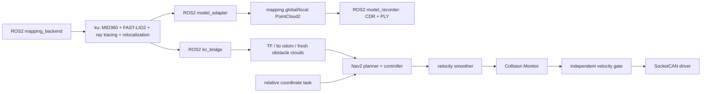

# ROS2 统一架构与队友接口（2026-10-23）

## 当前实现

统一入口为标准 ament_python 包 `tracer_bringup` 的 `system.launch.py`。建图后端、雷达／里程计适配、模型适配、模型保存和 Nav2 都由 ROS2 launch 管理。队友使用 ROS2 的话题、TF、参数、action 和 rosbag 接口，不必自行管理 LCM 订阅和多个建图脚本。

**内部兼容边界**：FAST-LIO2 和 Rust 光追建图仍是 ku 中原有进程，其内部数据经 LCM 传递；适配层将其转换为 ROS2。这次完成了 ROS2 管理和对外接口统一，没有把 Livox SDK／FAST-LIO2 重写为原生 rclcpp 驱动。内部 LCM 网络依赖仍需 `prepare_wsl.sh` 准备。避免将本版本描述成“已完全移除 LCM”。



大点云转换和模型保存各用独立进程，避免占用里程计和实时避障适配的回调时间。模型与导航地图继续分开：导航参考地图只读，三维建模持续更新；未知区域自主探索仍未实现。

## 编译和启动

本机已完成包编译。队友修改／复制代码后，在 Ubuntu 重新编译：

```bash
bash /mnt/d/未来机器人/tracer_navigation/build_ros2.sh
```

默认启动建图、重定位、模型记录和导航预览，**不启动底盘驱动**：

```bash
bash /mnt/d/未来机器人/tracer_navigation/start_ros2.sh
```

不要同时运行旧 `start_mapping_session.sh`、`start_fixed_map_relocalization.sh`、`start_navigation.sh` 或 `start_hardware.sh`。旧入口保留用于兼容和排障，新实验以统一入口为准。启动前仍执行 Windows USB-CAN 转接及 `prepare_wsl.sh`，保持此 Ubuntu 终端运行。

单独运行建图和适配／模型记录，不启动 Nav2：

```bash
bash /mnt/d/未来机器人/tracer_navigation/start_ros2.sh navigation:=false
```

正常启动等价的标准 ROS2 命令（需要先加载环境、准备网络并生成配置）：

```bash
source /mnt/d/未来机器人/tracer_navigation/ros_env.sh
export TRACER_PROJECT_ROOT=/mnt/d/未来机器人/tracer_navigation
ros2 launch tracer_bringup system.launch.py project_root:="$TRACER_PROJECT_ROOT"
```

包通过 `TRACER_PROJECT_ROOT` 加载工程代码及 `.ros_venv`，使用固定的 Python 3.10 导航环境；ku 仍由自己的 Python 3.12 环境运行。源码主目录留在 Windows，ament 安装目录在 `/home/ll175/tracer_nav_runtime/ws`，规避 Humble 工具对中文路径的限制。换电脑须重建依赖和包，本工程不是免安装运行包。

## ROS2 接口约定

| 接口 | ROS2 类型 | 帧／单位 | 生产者 | 使用方 |
|---|---|---|---|---|
| `/lidar/points` | sensor_msgs/msg/PointCloud2 | mid360_link，m；原始时间戳 | lio_bridge | 传感器排查、rosbag |
| `/lio/odom` | nav_msgs/msg/Odometry | odom → base_link；m、rad | lio_bridge | Nav2／距离核验 |
| `/points_navigation` | sensor_msgs/msg/PointCloud2 | base_link；m；已安装外参变换与自体过滤 | lio_bridge | Collision Monitor、独立门控 |
| `/points_navigation_sensor` | sensor_msgs/msg/PointCloud2 | mid360_link；m；同一批过滤回波 | lio_bridge | Nav2 障碍层，保留真实射线起点 |
| `/mapping/global_points` | sensor_msgs/msg/PointCloud2 | map；m；完整刚体重定位变换 | model_adapter | 模型保存、RViz、队友算法 |
| `/mapping/local_points` | sensor_msgs/msg/PointCloud2 | map；m | model_adapter | 局部模型显示／分析 |
| `/mapping/backend_status` | std_msgs/msg/String（JSON） | 进程 running/failed、pid、退出码 | mapping_backend | 运维；不代表定位成功 |
| `/mapping/status` | std_msgs/msg/String（JSON） | stream、frame、units、points、source_stamp | model_adapter | 观测模型流新鲜度 |
| `/mapping/recorder_status` | std_msgs/msg/String（JSON） | 最近保存目录、时间、点数 | model_recorder | 确认模型落盘 |
| `/navigation/localization_valid` | std_msgs/msg/Bool | 重定位与里程计新鲜度 | lio_bridge | 门控、任务 |
| `/navigation/perception_valid` | std_msgs/msg/Bool | 实时传感器有效性 | lio_bridge | 门控、任务 |
| `/map` | nav_msgs/msg/OccupancyGrid | map；m/格 | map_server | Nav2 参考地图 |
| `/compute_path_to_pose` | nav2_msgs/action/ComputePathToPose | map | planner_server | 只规划 |
| `/navigate_to_pose` | nav2_msgs/action/NavigateToPose | map | bt_navigator | 自动导航任务 |
| `/navigation/arm` | std_srvs/srv/SetBool | 请求解锁／上锁 | velocity gate | 有验收的任务入口 |
| `/navigation/safety_status` | std_msgs/msg/String（JSON） | gate mode、armed、reason、ages | velocity gate | 任务监控、诊断 |

原始／避障点云采用 SensorData QoS（best effort）；模型流为 reliable、depth=1、volatile，要求订阅者接收新数据，避免将旧模型当作当前观测。PointCloud2 保留采集时间，任何队友节点不得通过刷新 header 时间伪装新鲜数据。

TF 仅由 lio_bridge 负责发布 `map → odom → base_link → mid360_link`。不要让队友的定位节点重复发布相同 TF。底盘驱动反馈不额外争夺 odom TF。模型使用完整重定位矩阵，车体导航使用平面投影。

## 参数和任务入口

`system.launch.py` 参数：

| 参数 | 默认值 | 用途 |
|---|---|---|
| project_root | 本工程 tracer_navigation 路径 | 代码／配置／虚拟环境根目录 |
| navigation | true | 是否包含 Nav2 和速度门控 |
| enable_drive | false | 是否启动实车 CAN 驱动，受现场验收限制 |
| start_backend | true | false 用于已存在后端或离线数据测试；不会自动生成假定位 |
| output_dir | 空值 | 空时自动创建 model_sessions/ros2_日期_编号 |

底盘尺寸、外参、速度和 watchdog 的唯一配置源仍为 `robot.yaml`，`generate_config.py` 生成 Nav2 参数。坐标接口沿用：

```bash
bash /mnt/d/未来机器人/tracer_navigation/navigate_relative.sh 1.5 0.5
```

表示按任务发起时车头方向，目标在前进 1.5 m、左侧 0.5 m。默认只规划；新代码通过现场验收后，显式 `--execute` 才进入倒计时和一次真实任务。SDK 建图不会自行发布底盘运动命令。

统一预览中可运行原有零速、前进和左转验收脚本，要求与旧操作指南相同。预览验收结束，Ctrl+C 退出整套系统后才能切实车模式：

```bash
bash /mnt/d/未来机器人/tracer_navigation/start_ros2.sh enable_drive:=true
```

这会重新启动建图和重定位。务必再次确认点云与原图重合、所有节点 active、未解锁、底盘反馈正常，再发起任务。实车入口会先验证验收记录，再设置 CAN，退出时恢复只听模式。当前新软件验收无效，不能直接驾驶。

## 模型和录制

ROS2 保存格式：`model_sessions/ros2_*/latest.json` 指向完整快照，含 `model_map.ply`、`global_points.cdr`、`metadata.json`。CDR 的类型是 `sensor_msgs/msg/PointCloud2`，使用 `rclpy.serialization.deserialize_message` 读取。它与旧版 LCM 文件格式不同，元数据会明确 transport=ROS2。默认每约 10 秒保存，只保留本次运行最近两个快照。

团队联调可用标准 rosbag2：

```bash
ros2 bag record /lidar/points /lio/odom /tf /tf_static /mapping/global_points /mapping/local_points /navigation/safety_status
```

录制本身不驱动车辆；回放必须放在隔离的 ROS_DOMAIN_ID，不能向已连接实车的控制域回放运动命令。

## 生命周期和验证范围

后端由 mapping_backend 持有，退出时向其进程组发送 SIGINT，超时后 SIGTERM。ROS2 launch 内任何关键组件退出，均触发整套系统 Shutdown；故障时不自动重启或重新解锁。退出请求不是实车停车证明，仍需物理急停与轮速核对。

本次离线验证：包实际 colcon 编译、真实 launch 启动、模拟 LCM→ROS2 点云／定位、完整地图变换、CDR/PLY 保存及反序列化、无硬件速度发布者、关键组件退出导致系统关闭，共 9 项通过；另有 12 项安全测试和 13 项坐标／模型测试通过。证据在 `results/ros2_unification_20261023/`。未启动实车 CAN 驱动，未验证现场距离、反馈稳定性和实车到达。

## 文件清理结论

本次释放 3,178,559,364 字节（约 3.18 GB 十进制，2.96 GiB）：

- `队友交接包_20261019/` 解压副本：3,077 个文件逐个 SHA256 与保留的 `队友交接包_20261019.zip` 核对一致后删除，保留 ZIP、SHA256 和原校验报告，仍可解压恢复。
- `tracer_navigation/sdk_build/`：旧 CMake 构建缓存，现行构建使用 Linux ASCII runtime 目录。
- `tracer_navigation/__pycache__/`：可再生成 Python 字节码缓存。

保留原始地图、实验录制、现场故障／标定报告、原厂 SDK、FAST-LIO2／光追 release 二进制、虚拟环境、SDK install、Git 元数据及其他机器人源码。ku 仓库已有用户修改 `dimos/mapping/cli/map.py`，本次未覆盖或删除。不能凭静态搜索断言其他硬件模块无用，因此没有裁剪上游代码。

实际删除路径、逐文件核验数量、字节数和原因见 `results/ros2_unification_20261023/cleanup.json`。本次没有删除唯一数据副本。
